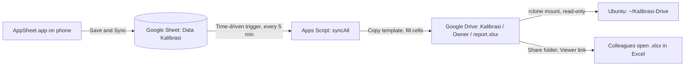

# Calibration Data Pipeline

Phone-based data entry for water meter calibration. AppSheet collects the readings, Google Sheets stores them, Apps Script builds one calibration report per meter in Google Drive, and rclone mounts the Drive folder on an Ubuntu laptop.

## Contents

1. [Overview](#1-overview)
2. [Components and prerequisites](#2-components-and-prerequisites)
3. [Part 1: Google Drive and the report template](#3-part-1-google-drive-and-the-report-template)
4. [Part 2: Template formulas](#4-part-2-template-formulas)
5. [Part 3: Data table in Google Sheets](#5-part-3-data-table-in-google-sheets)
6. [Part 4: AppSheet app](#6-part-4-appsheet-app)
7. [Part 5: Apps Script](#7-part-5-apps-script)
8. [Part 6: rclone on Ubuntu](#8-part-6-rclone-on-ubuntu)
9. [SOP: Daily use](#9-sop-daily-use)
10. [SOP: Maintenance of the rclone Google Drive mount](#10-sop-maintenance-of-the-rclone-google-drive-mount)
11. [Troubleshooting](#11-troubleshooting)
12. [Security and repository hygiene](#12-security-and-repository-hygiene)
13. [Limitations and open decisions](#13-limitations-and-open-decisions)

---

## 1. Overview

A field engineer records calibration readings for a meter under test and a standard meter on a phone. Within five minutes the pipeline writes the readings into a copy of the report template, computes the measurement error, and stores the report in a Google Drive folder named after the meter owner. An Ubuntu laptop shows the same folder as a read-only drive. Colleagues open the `.xlsx` reports in Microsoft Excel through a shared folder link.



Drive layout produced by the script:

```
Kalibrasi/
  <Owner A>/
    <Owner A>_<Location>_<Serial>_<yyyy-MM-dd>        (Google Sheets report)
    <Owner A>_<Location>_<Serial>_<yyyy-MM-dd>.xlsx   (Excel export)
  <Owner B>/
    ...
```

### Design decisions

| Decision | Reason |
|---|---|
| One data row maps to one report file | An edit to a data row updates the same file. The `Map` sheet stores the file IDs. |
| Google Sheets is the single source of truth | Two-way sync between a laptop file and Google Sheets creates conflicts. |
| The Ubuntu mount is read-only | A local edit cannot overwrite a report in Drive. |
| Formulas live in the template and in the app | The app shows the error percentage per point before the report exists. |
| The script runs on a time trigger | AppSheet writes to the sheet through the API, and the form-submit trigger does not fire for those writes. |

### Latency

| Step | Delay |
|---|---|
| Phone to Google Sheet | Seconds after Sync |
| Google Sheet to report in Drive | Up to 5 minutes (trigger interval) |
| Drive to the Ubuntu mount | About 30 seconds |

---

## 2. Components and prerequisites

| Component | Role |
|---|---|
| AppSheet (phone app and web editor) | Data entry, per-point error display |
| Google Sheets (`Data Kalibrasi`) | Data table, source of truth |
| Google Apps Script (bound to the sheet) | Builds and updates report files |
| Google Drive | Report storage and sharing |
| rclone with FUSE | Mounts Drive on Ubuntu |
| GitHub Pages (optional) | Hosts two static pages that Google requires to publish the OAuth app |

Prerequisites:

- One Google account for all components. Use the same account in AppSheet, Apps Script, Drive, and rclone.
- A phone with the AppSheet app installed (iOS or Android).
- An Ubuntu laptop with `sudo` access, a desktop session, and internet access.
- The report template as an `.xlsx` workbook. The scripts in this repository expect a sheet named `FM_Intek_(_7_)` and the cell layout in [Part 2](#4-part-2-template-formulas). Change the constants in the script if your template differs.

Column names in the data model are Indonesian. The script and the AppSheet formulas use these exact names.

| Column | Meaning |
|---|---|
| `Pemilik` | Meter owner (also the Drive folder name) |
| `Lokasi` | Location |
| `Kota` | City printed in the report date line |
| `Merk`, `Tipe` | Brand, type of the meter under test |
| `No Seri` | Serial number |
| `Kapasitas` | Capacity or nominal diameter (DN) |
| `Tanggal` | Calibration date |
| `Penguji` | Tester name |
| `PT Customer` | Customer company printed in the witness block |
| `Uji Awal n`, `Uji Akhir n` | Start and end totalizer of the meter under test, point n |
| `Standar Awal n`, `Standar Akhir n` | Start and end totalizer of the standard meter, point n |

---

## 3. Part 1: Google Drive and the report template

1. Open [drive.google.com](https://drive.google.com), select **New > New folder**, and name it `Kalibrasi`.
2. Open the folder and copy the **folder ID** from the address bar. It is the string after `/folders/`. Store it as `ROOT_FOLDER_ID`.
3. Upload the template workbook with **New > File upload**.
4. Right-click the file, select **Open with > Google Sheets**, then select **File > Save as Google Sheets**.
5. Rename the new Google Sheets file to `TEMPLATE Kalibrasi`.
6. Copy the **template ID** from the address bar. It is the string between `/d/` and `/edit`. Store it as `TEMPLATE_ID`.
7. Check the tab name at the bottom. It must match `TEMPLATE_SHEET` in the script (`FM_Intek_(_7_)` by default).

The `.xlsx` upload is a one-time conversion. Delete the uploaded `.xlsx` afterward so only the Google Sheets version remains.

---

## 4. Part 2: Template formulas

The script writes input cells and leaves all formulas untouched. Edit the formulas in the Google Sheets copy (`TEMPLATE Kalibrasi`) so each generated report inherits them.

### Cell map

| Cells | Content | Written by |
|---|---|---|
| `D10`, `D11` | Owner, location (value prefixed with `: `) | Script |
| `D14` to `D17` | Brand, type, serial number, capacity of the meter under test (prefixed with `: `) | Script |
| `G19` | `<City>, <day> <month> <year>` | Script |
| `G25` | `( <Tester> )` | Script |
| `G38` | `(  <Customer company>  )` | Script |
| `C22:D24` | Start and end totalizer, meter under test, 3 points | Script |
| `C29:D31` | Start and end totalizer, standard meter, 3 points | Script |
| `E22:E24`, `E29:E31` | Volume A and Volume B (`end - start`) | Template formulas |
| `C36:C38` | Error per point (%) | Template formulas |
| `D36` | Average error (%) | Template formula |
| `E36` | Tolerance (numeric `2`, number format `"±"0.0`) | Template |
| `E40` | Compliance statement | Template formula |

The standard meter identity (cells `H14` to `H16`) is fixed text in the template.

### Formulas

Error per point. Each cell stays blank until both totalizer pairs exist and shows `Vol B = 0` when the standard meter volume is zero.

```
C36: =IF(OR(COUNT(C29:D29)<2,COUNT(C22:D22)<2),"",IF(E29=0,"Vol B = 0",(E22-E29)/E29*100))
C37: =IF(OR(COUNT(C30:D30)<2,COUNT(C23:D23)<2),"",IF(E30=0,"Vol B = 0",(E23-E30)/E30*100))
C38: =IF(OR(COUNT(C31:D31)<2,COUNT(C24:D24)<2),"",IF(E31=0,"Vol B = 0",(E24-E31)/E31*100))
```

Average error. The cell stays blank until all three points have a numeric error.

```
D36: =IF(COUNT(C36:C38)<3,"",AVERAGE(C36:C38))
```

Compliance statement.

```
E40: =IF(D36="","",IF(ABS(D36)<=$E$36,"WM MEMENUHI"&CHAR(10)&"TOLERANSI","WM TIDAK MEMENUHI"&CHAR(10)&"TOLERANSI"))
```

Formatting:

- Set `E36` to the number `2` with the custom number format `"±"0.0`.
- Set the number format of `C36:D38` to `0.000`.
- Set the height of rows 40 and 41 to 40 pixels so the three-line failure text fits.

### Acceptance rule

The template judges tolerance on the **average** of the three point errors, as the original form did. An average hides compensating errors: points at +4%, -10%, and 0% average to -2.0% and pass a ±2.0% tolerance. If your calibration standard requires every point inside tolerance, use this formula in `E40`:

```
=IF(D36="","",IF(MAX(ABS(C36),ABS(C37),ABS(C38))<=$E$36,"WM MEMENUHI"&CHAR(10)&"TOLERANSI","WM TIDAK MEMENUHI"&CHAR(10)&"TOLERANSI"))
```

Apply the same rule in the AppSheet `Hasil` column ([Part 4](#6-part-4-appsheet-app)).

---

## 5. Part 3: Data table in Google Sheets

1. Create a new Google Sheets file named `Data Kalibrasi`.
2. Rename the first tab to `Kalibrasi`.
3. Put these headers in row 1, columns A to W. Type them, import them from a file, or paste the line into A1 and select **Data > Split text to columns** with a comma separator.

```
ID,Pemilik,Lokasi,Merk,Tipe,No Seri,Kapasitas,Tanggal,Penguji,PT Customer,Uji Awal 1,Uji Akhir 1,Uji Awal 2,Uji Akhir 2,Uji Awal 3,Uji Akhir 3,Standar Awal 1,Standar Akhir 1,Standar Awal 2,Standar Akhir 2,Standar Awal 3,Standar Akhir 3,Kota
```

4. Leave rows 2 and below empty. The app fills them.

Spelling and spacing of each header must match the script. A new column goes to the right of `Kota`. Order does not matter to the script because it reads columns by header name.

---

## 6. Part 4: AppSheet app

### Create the app

1. Open [appsheet.com](https://www.appsheet.com) and sign in with the same Google account.
2. Select **Create > App > Start with existing data**.
3. Name the app `Kalibrasi Meter Air`, then pick the `Data Kalibrasi` file and the `Kalibrasi` tab.

### Column settings

Open **Data > Tables > Kalibrasi > Columns**.

| Column | Type | Key | Show | Require | Initial value |
|---|---|---|---|---|---|
| `ID` | Text | Yes | No | Yes | `UNIQUEID()` |
| `Pemilik`, `Lokasi`, `Merk`, `Tipe`, `No Seri`, `Kapasitas`, `Penguji`, `PT Customer` | Text | No | Yes | Yes | |
| `Kota` | Text | No | Yes | Yes | `"Jakarta"` |
| `Tanggal` | Date | No | Yes | Yes | `TODAY()` |
| `Uji Awal 1`, `Uji Akhir 1`, `Standar Awal 1`, `Standar Akhir 1` | Decimal | No | Yes | Yes | |
| Same four columns for points 2 and 3 | Decimal | No | Yes | **No** | |

Points 2 and 3 are optional so you can save point 1, read its error, and fix it before you continue.

AppSheet shows a warning that column `ID` is unsearchable because it is hidden. The warning is harmless.

Set **Adds** and **Updates** to allowed under the table settings. Updates make saved records editable.

### Virtual columns

Select **Add Virtual Column** for each row below. Enter the formula first. AppSheet shows the **Type** field after the formula exists. Set **Decimal digits** (the `Type Details` precision) to `3` on every Decimal virtual column. AppSheet rejects a Decimal column with precision `0`.

| Name | Type | App formula |
|---|---|---|
| `Error 1` | Decimal | `IF(([Standar Akhir 1]-[Standar Awal 1])=0,"",(([Uji Akhir 1]-[Uji Awal 1])-([Standar Akhir 1]-[Standar Awal 1]))/([Standar Akhir 1]-[Standar Awal 1])*100)` |
| `Error 2` | Decimal | Same formula with `1` replaced by `2` |
| `Error 3` | Decimal | Same formula with `1` replaced by `3` |
| `Rata Rata Error` | Decimal | `IF(OR(ISBLANK([Error 1]),ISBLANK([Error 2]),ISBLANK([Error 3])),"",([Error 1]+[Error 2]+[Error 3])/3)` |
| `Hasil` | Text | `IF(ISBLANK([Rata Rata Error]),"",IF(ABS([Rata Rata Error])<=2,"WM MEMENUHI TOLERANSI","WM TIDAK MEMENUHI TOLERANSI"))` |

The formulas expand `Volume A = end - start` and `Volume B = end - start` inline because the data table stores raw totalizer values. Results match the template cells `C36:C38`.

For shorter formulas, add `Vol A n` (`[Uji Akhir n]-[Uji Awal n]`) and `Vol B n` (`[Standar Akhir n]-[Standar Awal n]`) as virtual Decimal columns, then use `IF([Vol B n]=0,"",([Vol A n]-[Vol B n])/[Vol B n]*100)` for `Error n`.

### Form layout

AppSheet does not place two fields on the same row of a form. Group each point instead:

1. Add four virtual columns of type `Show` with category `Section_Header` and the content expressions `"TITIK 1"`, `"TITIK 2"`, `"TITIK 3"`, and `"HASIL"` (names: `Judul Titik 1`, `Judul Titik 2`, `Judul Titik 3`, `Judul Hasil`).
2. Open **UX > Views**, select the form view of the `Kalibrasi` table, and set **Column order** to **Manual**.
3. Order the columns:

| Group | Columns |
|---|---|
| Identity | `Pemilik`, `Lokasi`, `Kota`, `Merk`, `Tipe`, `No Seri`, `Kapasitas`, `Tanggal`, `Penguji`, `PT Customer` |
| Point 1 | `Judul Titik 1`, `Uji Awal 1`, `Uji Akhir 1`, `Standar Awal 1`, `Standar Akhir 1`, `Error 1` |
| Point 2 | `Judul Titik 2`, `Uji Awal 2`, `Uji Akhir 2`, `Standar Awal 2`, `Standar Akhir 2`, `Error 2` |
| Point 3 | `Judul Titik 3`, `Uji Awal 3`, `Uji Akhir 3`, `Standar Awal 3`, `Standar Akhir 3`, `Error 3` |
| Result | `Judul Hasil`, `Rata Rata Error`, `Hasil` |

To show one point per screen, change the point headers to category `Page_Header` and set the form page style to **Tabs**.

### Adding a column later

Add the header in row 1 of the sheet, then select **Regenerate Structure** on the table's **Columns** tab. AppSheet adds the new column at the end. Set its type, **Require**, and initial value, then save the app.

### Install on the phone

1. Install **AppSheet** from the App Store or Google Play.
2. Sign in with the same Google account.
3. Open `Kalibrasi Meter Air` from **My apps**.
4. Tap **+** to add a record. Tap **Save**, then **Sync**.
5. Tap a record, then the pencil icon, to edit it.

The app can stay in the **Not Deployed** state for personal use. The app works offline and sends records when the phone reconnects.

---

## 7. Part 5: Apps Script

The script lives inside the `Data Kalibrasi` spreadsheet so that `SpreadsheetApp.getActive()` resolves to the data table.

### Install

1. In `Data Kalibrasi`, select **Extensions > Apps Script**.
2. Delete the default code and paste the script below.
3. Replace `PASTE_ROOT_FOLDER_ID` with `ROOT_FOLDER_ID` and `PASTE_TEMPLATE_SPREADSHEET_ID` with `TEMPLATE_ID` from [Part 1](#3-part-1-google-drive-and-the-report-template).
4. Save the project (name it `Kalibrasi Otomatis`).
5. Select `syncAll` in the function dropdown and click **Run**. In the permission dialog choose your account, then **Advanced > Go to Kalibrasi Otomatis (unsafe) > Allow**. Google shows the warning because the script is unverified and you wrote it.

### Script

```javascript
// Config: replace with your own values
const ROOT_FOLDER_ID = 'PASTE_ROOT_FOLDER_ID';
const TEMPLATE_ID    = 'PASTE_TEMPLATE_SPREADSHEET_ID';
const TEMPLATE_SHEET = 'FM_Intek_(_7_)';
const DATA_SHEET     = 'Kalibrasi';
const MAP_SHEET      = 'Map';       // created by the script, do not edit by hand
const EXPORT_XLSX    = true;        // also save an .xlsx copy next to the Google Sheet
const FOLDER_FIELD   = 'Pemilik';   // column used as the company folder name
const MONTHS = ['Januari', 'Februari', 'Maret', 'April', 'Mei', 'Juni', 'Juli',
                'Agustus', 'September', 'Oktober', 'November', 'Desember'];

function syncAll() {
  const lock = LockService.getScriptLock();
  if (!lock.tryLock(30000)) return;
  try {
    const ss = SpreadsheetApp.getActive();
    const data = ss.getSheetByName(DATA_SHEET);
    const map = getMapSheet_(ss);

    const rows = data.getDataRange().getValues();
    if (rows.length < 2) return;
    const headers = rows[0].map(h => String(h).trim());

    // Map sheet columns: ID | FileId | Signature | XlsxId
    const known = {};
    map.getDataRange().getValues().slice(1).forEach((m, i) => {
      known[m[0]] = { row: i + 2, fileId: m[1], signature: m[2], xlsxId: m[3] };
    });

    for (let i = 1; i < rows.length; i++) {
      const rec = {};
      headers.forEach((h, c) => (rec[h] = rows[i][c]));
      const id = String(rec['ID']).trim();
      if (!id) continue;

      const signature = JSON.stringify(rows[i]);
      const prev = known[id];
      if (prev && prev.signature === signature) continue; // nothing changed
      if (!isComplete_(rec)) continue;                    // wait for required fields

      let res;
      try {
        res = writeFile_(rec, prev);
      } catch (err) {
        console.error('Row ' + id + ' failed: ' + err);    // skip this row, keep processing the rest
        continue;
      }
      if (prev) {
        map.getRange(prev.row, 2, 1, 3).setValues([[res.fileId, signature, res.xlsxId]]);
      } else {
        map.appendRow([id, res.fileId, signature, res.xlsxId]);
      }
    }
  } finally {
    lock.releaseLock();
  }
}

function writeFile_(rec, prev) {
  const t = k => (rec[k] === undefined || rec[k] === null) ? '' : String(rec[k]).trim();
  const city = t('Kota') || 'Jakarta'; // falls back to Jakarta when the column is empty

  const root = DriveApp.getFolderById(ROOT_FOLDER_ID);
  const folder = getOrCreateFolder_(root, clean_(t(FOLDER_FIELD)));
  const date = toDate_(rec['Tanggal']);
  const fileName = `${clean_(t('Pemilik'))}_${clean_(t('Lokasi'))}_${clean_(t('No Seri'))}_` +
    Utilities.formatDate(date, Session.getScriptTimeZone(), 'yyyy-MM-dd');

  // Reuse the existing file when it still exists; otherwise copy the template again
  let file = getLiveFile_(prev && prev.fileId);
  if (file) {
    file.setName(fileName);
    file.moveTo(folder);
  } else {
    file = DriveApp.getFileById(TEMPLATE_ID).makeCopy(fileName, folder);
  }

  const sh = SpreadsheetApp.openById(file.getId()).getSheetByName(TEMPLATE_SHEET);

  // Header cells keep the ": " prefix used by the template
  sh.getRange('D10').setValue(': ' + t('Pemilik'));
  sh.getRange('D11').setValue(': ' + t('Lokasi'));
  sh.getRange('D14').setValue(': ' + t('Merk'));
  sh.getRange('D15').setValue(': ' + t('Tipe'));
  sh.getRange('D16').setValue(': ' + t('No Seri'));
  sh.getRange('D17').setValue(': ' + t('Kapasitas'));
  sh.getRange('G19').setValue(
    `${city}, ${date.getDate()} ${MONTHS[date.getMonth()]} ${date.getFullYear()}`);

  // Signature block: tester and customer company
  sh.getRange('G25').setValue(`( ${t('Penguji')} )`);
  sh.getRange('G38').setValue(`(  ${t('PT Customer')}  )`);

  // Table 1 (meter under test) and Table 2 (standard meter)
  sh.getRange('C22:D24').setValues(readPoints_(rec, 'Uji'));
  sh.getRange('C29:D31').setValues(readPoints_(rec, 'Standar'));
  SpreadsheetApp.flush();

  let xlsxId = '';
  if (EXPORT_XLSX) xlsxId = exportXlsx_(file.getId(), fileName, folder, prev && prev.xlsxId);
  return { fileId: file.getId(), xlsxId: xlsxId };
}

function readPoints_(rec, prefix) {
  const rows = [];
  for (let i = 1; i <= 3; i++) {
    rows.push([toNumber_(rec[`${prefix} Awal ${i}`]), toNumber_(rec[`${prefix} Akhir ${i}`])]);
  }
  return rows;
}

function exportXlsx_(id, name, folder, oldXlsxId) {
  const url = `https://docs.google.com/spreadsheets/d/${id}/export?format=xlsx`;
  const blob = UrlFetchApp.fetch(url, {
    headers: { Authorization: 'Bearer ' + ScriptApp.getOAuthToken() },
  }).getBlob().setName(name + '.xlsx');
  if (oldXlsxId) {
    try { DriveApp.getFileById(oldXlsxId).setTrashed(true); } catch (err) {}
  }
  return folder.createFile(blob).getId();
}

function isComplete_(rec) {
  return ['Pemilik', 'Lokasi', 'No Seri', 'Tanggal'].every(k => String(rec[k]).trim() !== '');
}

function getMapSheet_(ss) {
  let sh = ss.getSheetByName(MAP_SHEET);
  if (!sh) {
    sh = ss.insertSheet(MAP_SHEET);
    sh.appendRow(['ID', 'FileId', 'Signature', 'XlsxId']);
  }
  return sh;
}

function getOrCreateFolder_(parent, name) {
  const it = parent.getFoldersByName(name);
  return it.hasNext() ? it.next() : parent.createFolder(name);
}

function getLiveFile_(fileId) {
  if (!fileId) return null;
  try {
    const f = DriveApp.getFileById(fileId);
    return f.isTrashed() ? null : f;
  } catch (err) {
    return null; // the file was deleted
  }
}

function toDate_(v) {
  if (v instanceof Date) return v;
  const s = String(v).trim();
  // Text dates such as 01/10/2026 are read as day/month/year
  const m = s.match(/^(\d{1,2})[\/\-.](\d{1,2})[\/\-.](\d{4})/);
  if (m) {
    let d = Number(m[1]), mo = Number(m[2]);
    if (mo > 12) { const tmp = d; d = mo; mo = tmp; } // month/day/year with a day above 12
    return new Date(Number(m[3]), mo - 1, d);
  }
  return new Date(s); // ISO text such as 2026-10-01
}

function toNumber_(v) {
  if (v === '' || v === null || v === undefined) return '';
  return Number(String(v).replace(',', '.'));
}

function clean_(s) { return String(s).trim().replace(/[\/\\:*?"<>|]/g, '-'); }
```

<details>
<summary>Diagnostic function (optional)</summary>

Add this function to the same file. It reads the data table and logs why a row is processed or skipped. It changes nothing.

```javascript
function debugSync() {
  const ss = SpreadsheetApp.getActive();
  const data = ss.getSheetByName(DATA_SHEET);
  const map = getMapSheet_(ss);
  const rows = data.getDataRange().getValues();
  const headers = rows[0].map(h => String(h).trim());
  const mapIds = map.getDataRange().getValues().slice(1).map(r => String(r[0]));

  console.log('Headers: ' + headers.join(' | '));
  console.log('Data rows: ' + (rows.length - 1) + ', Map rows: ' + mapIds.length);

  for (let i = 1; i < rows.length; i++) {
    const rec = {};
    headers.forEach((h, c) => (rec[h] = rows[i][c]));
    const id = String(rec['ID']).trim();
    const missing = ['Pemilik', 'Lokasi', 'No Seri', 'Tanggal']
      .filter(k => String(rec[k]).trim() === '');
    console.log('Row ' + (i + 1) + ': ID=' + (id || '(blank)') +
      ', inMap=' + mapIds.includes(id) +
      ', missing=' + (missing.join(',') || 'none'));
  }
}
```

</details>

### Script behavior

| Situation | Result |
|---|---|
| New row with `ID`, `Pemilik`, `Lokasi`, `No Seri`, `Tanggal` filled | The script copies the template, fills it, exports an `.xlsx`, and records the IDs in `Map` |
| Existing row edited | The script updates the same file, renames it if needed, and replaces the `.xlsx` |
| Owner changed on an existing row | The script moves the file to the new owner folder |
| Report file deleted from Drive, row and `Map` entry still present | The script copies the template again for that row |
| One row throws an error | The script logs the error and continues with the next row |
| Required field empty | The script skips the row until the field is filled |

### Trigger

1. In Apps Script, select the **Triggers** clock icon, then **Add Trigger**.
2. Set:

| Setting | Value |
|---|---|
| Function to run | `syncAll` |
| Deployment | `Head` |
| Event source | `Time-driven` |
| Type of time based trigger | `Minutes timer` |
| Minute interval | `Every 5 minutes` |

3. Select **Save** and authorize if Google asks.
4. Open **Executions**. A `syncAll` row with status `Completed` appears every five minutes.

Without the trigger the script runs only when you click **Run**. A one-minute interval risks the daily trigger runtime quota of a free Google account (about 90 minutes per day).

### End-to-end test

1. In the app, add a record with realistic readings, for example meter under test `100` to `110.1`, standard meter `200` to `210` for point 1. Fill points 2 and 3 as well.
2. Save and sync. Wait up to five minutes, or run `syncAll` by hand.
3. Open `Kalibrasi/<Owner>/` in Drive. One Google Sheets file and one `.xlsx` file appear.
4. Check the header cells, the date line, Table 3, and the compliance statement.
5. Edit one number in the app and sync. After five minutes the same file shows the new values and the file count stays at two.

---

## 8. Part 6: rclone on Ubuntu

rclone mounts the Drive folder `Kalibrasi` as `~/Kalibrasi-Drive`. The mount is read-only and skips Google-native files, so only the `.xlsx` exports appear.

All commands run in a terminal. Paste with `Ctrl+Shift+V`.

### 8.1 Install

```bash
sudo apt update
sudo apt install -y curl fuse3
sudo -v ; curl https://rclone.org/install.sh | sudo bash
rclone version
```

The official script installs a newer rclone than the `apt` package.

### 8.2 Create your own Google OAuth client

rclone's shared Google Drive client ID is retired during 2026. Create your own client ID. The steps below follow the rclone documentation for a personal Drive.

1. Open [console.developers.google.com](https://console.developers.google.com) and sign in.
2. Create a project named `rclone` and select it.
3. Select **Enable APIs and Services**, search for `Google Drive API`, and enable it.
4. Select **Credentials > Configure Consent Screen > Get started**. Enter the app name `rclone`, your support email, audience **External**, and your contact email. Accept the policy and select **Create**.
5. Open **Data Access > Add or remove scopes**. Paste the scopes below into **Manually add scopes**, select **Add to table**, **Update**, then **Save**.

```
https://www.googleapis.com/auth/docs,https://www.googleapis.com/auth/drive,https://www.googleapis.com/auth/drive.metadata.readonly,https://www.googleapis.com/auth/drive.readonly
```

6. Open **Audience > Test users**, add your Google account email, and save.
7. Open **Branding** and fill in the home page and privacy policy URLs (see below). Google requires both before it lets you publish.
8. Open **Overview > Create OAuth client**, choose **Desktop app**, and select **Create**. Store the **Client ID** and **Client secret** in a password manager. Do not paste the secret into chat, issues, or commits.
9. Open **Audience** and select **Publish app**. An app left in **Testing** issues refresh tokens that expire after 7 days. A published app does not.

Google still shows an "unverified app" warning during login. Select **Advanced > Go to rclone (unsafe)**. The warning is expected for a personal client.

#### Branding pages on GitHub Pages

Create a public repository named `YOUR_GITHUB_USERNAME.github.io` and add these files. Wait one to three minutes, then open both URLs in a browser to confirm they load.

`index.html`:

```html
<!DOCTYPE html>
<html>
<head><meta charset="utf-8"><title>rclone personal client</title></head>
<body>
<h1>rclone personal client</h1>
<p>Personal OAuth client used by its owner to read their own Google Drive files with rclone. Not available to the public.</p>
<p><a href="privacy.html">Privacy policy</a></p>
</body>
</html>
```

`privacy.html`:

```html
<!DOCTYPE html>
<html>
<head><meta charset="utf-8"><title>Privacy policy</title></head>
<body>
<h1>Privacy policy</h1>
<p>This application is for personal use by its owner. It reads the owner's Google Drive files to show them on the owner's computer. It does not collect, store, share, or sell data to third parties.</p>
</body>
</html>
```

In **Branding**, set:

| Field | Value |
|---|---|
| Application home page | `https://YOUR_GITHUB_USERNAME.github.io/` |
| Application privacy policy link | `https://YOUR_GITHUB_USERNAME.github.io/privacy.html` |
| Authorized domains | `YOUR_GITHUB_USERNAME.github.io` |

The terms of service link is optional. If Google insists on it, add a `terms.html` page with a short statement that the client is a personal tool and offers no service to third parties.

### 8.3 Connect rclone to Drive

```bash
rclone config
```

| Prompt | Answer |
|---|---|
| `e/n/d/r/s/q>` | `n` |
| `name>` | `gdrive` |
| `Storage>` | `drive` |
| `client_id>` | Paste your Client ID |
| `client_secret>` | Paste your Client secret |
| `scope>` | `2` (read-only) |
| `service_account_file>` | Enter |
| `Edit advanced config?` | `n` |
| `Use web browser to automatically authenticate rclone with remote?` | `y` |
| `Configure this as a Shared Drive?` | `n` |
| `Yes this is OK` | `y` |
| `e/n/d/r/c/s/q>` | `q` |

A browser window opens. Sign in, then select **Advanced > Go to rclone (unsafe) > Allow**. The page shows "Success!".

To change an existing remote, answer `e` at the first prompt, select the remote, and paste the new values. Leave `client_id` filled in. A blank `client_id` makes rclone fall back to the retired shared client.

### 8.4 Test the connection

```bash
rclone lsd gdrive:
rclone lsf gdrive:Kalibrasi --drive-skip-gdocs
```

The first command lists the top-level Drive folders without a `NOTICE` about a retired client ID. The second lists the owner folders. If `Kalibrasi` sits inside another folder, include the path, for example `gdrive:Work/Kalibrasi`.

Confirm that the stored client ID is your own (this command prints no secret):

```bash
rclone config show gdrive | grep client_id
```

### 8.5 Mount

```bash
mkdir -p ~/Kalibrasi-Drive
rclone mount gdrive:Kalibrasi ~/Kalibrasi-Drive \
  --drive-skip-gdocs --read-only \
  --dir-cache-time 30s --poll-interval 15s \
  --vfs-cache-mode full \
  --daemon --log-file="$HOME/rclone-mount.log" -v
```

| Flag | Purpose |
|---|---|
| `--drive-skip-gdocs` | Hides Google Sheets files so they do not collide with the `.xlsx` exports of the same name |
| `--read-only` | Blocks writes from the laptop |
| `--dir-cache-time 30s`, `--poll-interval 15s` | New files show up within about 30 seconds |
| `--vfs-cache-mode full` | Keeps a local cache of opened files for reliable reads in LibreOffice |
| `--daemon` | Runs in the background and returns the prompt |
| `--log-file`, `-v` | Writes a log to `~/rclone-mount.log` |

Without `--daemon`, `rclone mount` holds the terminal until you press `Ctrl+C`. That is normal behavior.

Check the mount:

```bash
findmnt ~/Kalibrasi-Drive
ls -R ~/Kalibrasi-Drive
```

`findmnt` prints one `fuse.rclone` row with the `ro` option. `ls -R` lists the owner folders and the `.xlsx` files.

Unmount:

```bash
fusermount -u ~/Kalibrasi-Drive
```

### 8.6 Start the mount at login

```bash
mkdir -p ~/.config/autostart
nano ~/.config/autostart/rclone-kalibrasi.desktop
```

Content:

```
[Desktop Entry]
Type=Application
Name=Mount Kalibrasi
Exec=sh -c "sleep 15; mkdir -p $HOME/Kalibrasi-Drive; rclone mount gdrive:Kalibrasi $HOME/Kalibrasi-Drive --drive-skip-gdocs --read-only --dir-cache-time 30s --poll-interval 15s --vfs-cache-mode full --log-file=$HOME/rclone-mount.log -v"
X-GNOME-Autostart-enabled=true
```

The 15-second delay gives the network time to connect. Raise it to 40 seconds if the folder is empty after login.

Test: unmount, restart the laptop, wait 15 seconds after login, then run `findmnt ~/Kalibrasi-Drive`.

### 8.7 Sidebar shortcut

Open `~/Kalibrasi-Drive` in Files and press `Ctrl+D`.

### 8.8 Offline copy (optional)

The mount needs internet. Copy the reports to local storage when you need offline access:

```bash
rclone copy gdrive:Kalibrasi ~/Documents/Kalibrasi --drive-skip-gdocs -v
```

Use `~/Dokumen` on an Indonesian-language Ubuntu. `copy` adds and updates files and removes nothing. `sync` mirrors Drive and deletes local files that no longer exist in Drive.

---

## 9. SOP: Daily use

### SOP-1: Record a new calibration

Owner: field engineer. Tools: phone with AppSheet.

1. Open `Kalibrasi Meter Air` in AppSheet.
2. Tap **+**.
3. Fill in the identity block: owner, location, city, brand, type, serial number, capacity, date, tester, and customer company.
4. Fill in **TITIK 1**: start and end totalizer of the meter under test, then of the standard meter.
5. Tap **Save**, then **Sync**.
6. Open the record and read `Error 1`.
7. If `Error 1` falls outside the tolerance (±2.0%), follow SOP-2 and repeat the test.
8. Add points 2 and 3 the same way. After the third point, `Rata Rata Error` and `Hasil` appear.

Pass condition: `Hasil` reads `WM MEMENUHI TOLERANSI` and the Drive report shows the same values after five minutes.

### SOP-2: Correct a reading or repeat a test

1. Tap the record, then the pencil icon.
2. Overwrite the totalizer values of the affected point with the new readings.
3. Tap **Save**, then **Sync**.
4. Read the new `Error n` value.

The script updates the existing report file. It does not create a second file. Wait up to five minutes for Drive and about 30 seconds more for the laptop mount.

Edit data in the app only. The script overwrites input cells in the report the next time the record changes, and changes made by hand in the report do not flow back to the app.

### SOP-3: Read reports on the Ubuntu laptop

1. Confirm the mount: `findmnt ~/Kalibrasi-Drive`.
2. Open `~/Kalibrasi-Drive/<Owner>/` in Files and open the `.xlsx` file in LibreOffice Calc.
3. Select **File > Reload** in LibreOffice after the report changes while you have the file open.
4. Copy the file to another folder before you annotate or edit it. The mount is read-only.

### SOP-4: Share reports with colleagues

1. In Drive, right-click the **owner folder** (not the root `Kalibrasi` folder) and select **Share**.
2. Set access to **Anyone with the link** and the role to **Viewer**.
3. Send the link. Colleagues open the `.xlsx` in Microsoft Excel or the Google Sheets file in a browser.

Sharing the root folder exposes the reports of all owners. Share one owner folder per recipient group. Remove link access when the engagement ends.

### SOP-5: Remove a record

Delete in this order so the script does not recreate the report:

1. Delete the data row in the `Kalibrasi` tab of `Data Kalibrasi` (or delete the record in the app).
2. Delete the matching row in the `Map` tab (match the `ID` column).
3. Delete the two report files (Google Sheets and `.xlsx`) from the owner folder in Drive.

If you delete only the Drive files, the script copies the template again for the data row on its next run.

---

## 10. SOP: Maintenance of the rclone Google Drive mount

### Schedule

| Frequency | Task | Command or place | Expected result |
|---|---|---|---|
| After each login | Check the mount | `findmnt ~/Kalibrasi-Drive` | One `fuse.rclone` row with `ro` |
| After each login | Check the content | `ls -R ~/Kalibrasi-Drive` | Owner folders and `.xlsx` files |
| Weekly | Check the OAuth publishing status | Google Cloud console, **Audience** | `In production`. If it reads `Testing`, run procedure M-2 every 7 days |
| Weekly | Check the script runs | Apps Script, **Executions** | `syncAll` rows with status `Completed` every 5 minutes |
| Monthly | Update rclone | Procedure M-5 | `rclone version` shows the latest release |
| Monthly | Trim the log | `: > ~/rclone-mount.log` | Empty log file |
| Quarterly | Review apps with Drive access | [myaccount.google.com/connections](https://myaccount.google.com/connections) | Only `rclone` and AppSheet appear |
| Quarterly | Check the Google Cloud project | Google Cloud console | Project `rclone` is active and the Drive API is enabled |

### M-1: Mount is missing after login

1. Run `findmnt ~/Kalibrasi-Drive`. No output means the mount is not active.
2. Read the log: `tail -n 20 ~/rclone-mount.log`.
3. Remove a stale mount: `fusermount -u ~/Kalibrasi-Drive`.
4. Mount again with the command in [section 8.5](#85-mount).
5. If the folder stays empty after login on a slow network, raise `sleep 15` to `sleep 40` in `~/.config/autostart/rclone-kalibrasi.desktop`.

### M-2: Token expired or revoked (`invalid_grant`, `Token has been expired`)

1. Unmount: `fusermount -u ~/Kalibrasi-Drive`.
2. Issue a new token: `rclone config reconnect gdrive:`.
3. Answer `y` to replace the token, sign in, and select **Advanced > Go to rclone (unsafe) > Allow**.
4. Mount again.

### M-3: `invalid_client` or "The OAuth client was not found"

1. Print the stored client ID: `rclone config show gdrive | grep client_id`.
2. Compare it with the Client ID in the Google Cloud console under **Credentials**. Check the beginning, the end, and stray spaces.
3. A client ID that is blank means rclone uses the retired shared client. Edit the remote (`rclone config`, `e`) and fill in `client_id` and `client_secret`.
4. A client created minutes ago may need 10 to 15 minutes before Google recognizes it.
5. After the fix, run `rclone config reconnect gdrive:`.

### M-4: `Transport endpoint is not connected`

A previous mount process died and left a stale mount point.

```bash
fusermount -u ~/Kalibrasi-Drive
```

Then mount again. Use `fusermount3 -u` if `fusermount` is missing.

### M-5: Update rclone

```bash
rclone version
sudo -v ; curl https://rclone.org/install.sh | sudo bash
rclone version
```

Unmount before the update and mount again afterward.

### M-6: Slow mount

1. Measure the Drive listing: `time rclone lsf gdrive:Kalibrasi --drive-skip-gdocs`.
2. A result under five seconds points to the mount settings. A result above 15 seconds points to the network.
3. Turn off the VPN and test again.
4. Force IPv4: add `--bind 0.0.0.0` to the mount command and to the autostart file.
5. Run the mount in the foreground with `-vv` and read the messages. `rateLimitExceeded` or `429` means Google throttles requests. Wait a few minutes.

### M-7: Rotate the OAuth client secret

1. In the Google Cloud console, open **Credentials**, select the Desktop client, and add a new secret. Disable the old secret after the test.
2. Run `rclone config`, select `e`, choose `gdrive`, paste the new secret, and keep all other values.
3. Run `rclone config reconnect gdrive:` and mount again.

### M-8: Respond to a leaked token or secret

Treat any `token`, `refresh_token`, or `client_secret` that appears in a chat, issue, log, or commit as compromised.

1. Unmount: `fusermount -u ~/Kalibrasi-Drive`.
2. Open [myaccount.google.com/connections](https://myaccount.google.com/connections), select `rclone`, and choose **Delete all connections**.
3. For a leaked `client_secret`, rotate it (M-7).
4. Run `rclone config reconnect gdrive:` and mount again.
5. Purge a leaked value from Git history, not only from the latest commit.

### M-9: Decommission a laptop

1. `fusermount -u ~/Kalibrasi-Drive`
2. `rclone config delete gdrive`
3. `rm ~/.config/autostart/rclone-kalibrasi.desktop`
4. `rm -rf ~/.cache/rclone ~/Kalibrasi-Drive ~/rclone-mount.log`
5. Remove the `rclone` entry at [myaccount.google.com/connections](https://myaccount.google.com/connections).

### M-10: Rebuild on a new machine

1. Install rclone ([section 8.1](#81-install)).
2. Run `rclone config` with the existing Client ID and Client secret ([section 8.3](#83-connect-rclone-to-drive)).
3. Test the connection ([section 8.4](#84-test-the-connection)).
4. Mount and add the autostart file ([sections 8.5 and 8.6](#85-mount)).

The data, the script, and the app live in Google. A new laptop needs only rclone and the OAuth client credentials.

---

## 11. Troubleshooting

| Symptom | Likely cause | Fix |
|---|---|---|
| New record never becomes a report | Time trigger missing | Add the `syncAll` trigger ([Part 5](#7-part-5-apps-script)) and run `syncAll` once by hand |
| `Executions` shows `No item with the given ID could be found` | Template ID, folder ID, or a deleted file | Check both IDs. Remove the stale row in `Map` |
| `Cannot read properties of null (reading 'getRange')` | `TEMPLATE_SHEET` does not match the template tab name | Fix the constant |
| `Cannot read properties of null (reading 'getDataRange')` | `DATA_SHEET` does not match the data tab name | Fix the constant or rename the tab |
| Row is skipped | `ID`, `Pemilik`, `Lokasi`, `No Seri`, or `Tanggal` is empty | Complete the record. Run `debugSync` to see the reason per row |
| `ID` column empty in the sheet | `UNIQUEID()` initial value missing in AppSheet | Set the initial value, save the app, and add a new record |
| Date in the report is wrong (day and month swapped) | AppSheet wrote the date as text | Inspect the `Tanggal` cell format and adapt `toDate_` |
| Table 3 shows `Vol B = 0` | The standard meter volume is zero | Check the standard meter readings |
| Average and result stay blank | One of the three points has no valid error | Complete all three points |
| AppSheet error `invalid 'Precision' 0` on a virtual column | Decimal digits not set | Set **Decimal digits** to 3 on the column |
| New sheet column not visible in the app | AppSheet has not read the new header | **Regenerate Structure**, set the column type, save |
| `Access blocked: ... has not completed the Google verification process` | Your email is not a test user, or the app is unpublished | Add the email under **Audience > Test users**, or publish the app |
| Mount folder empty | Mount inactive, or no `.xlsx` exists in Drive | M-1, then confirm `EXPORT_XLSX = true` and files exist in Drive |
| Opened file shows old data | LibreOffice keeps the loaded copy | **File > Reload** |

---

## 12. Security and repository hygiene

Do not commit any of these to this repository:

- `~/.config/rclone/rclone.conf` (holds the refresh token and the client secret)
- The OAuth Client secret
- Output of `rclone config show` that includes `token` or `client_secret`
- Real owner names, customer names, or calibration data
- Folder IDs and template IDs from your own Drive (use the `PASTE_...` placeholders)

Suggested `.gitignore`:

```
rclone.conf
*.conf
*.xlsx
*.log
.env
```

Safe diagnostic command that prints no secret:

```bash
rclone config show gdrive | grep client_id
```

Scope choices:

- rclone uses the read-only Drive scope (`scope> 2`). A leaked token cannot change or delete Drive files.
- The mount runs with `--read-only` as a second layer.
- The Apps Script project requests broader Drive access because it creates and edits files. Keep the spreadsheet private to your account.

---

## 13. Limitations and open decisions

| Item | Detail |
|---|---|
| Report delay | Up to five minutes between Sync and the Drive report, set by the trigger interval |
| Mount needs internet | Opened files are cached, but the folder list is empty offline. Use the offline copy in [section 8.8](#88-offline-copy-optional) |
| Trigger quota | A free Google account has about 90 minutes of trigger runtime per day. Keep the interval at 5 minutes or longer |
| AppSheet plan | Check the current AppSheet pricing and user limits before you share the app with other users |
| Manual edits in reports | Changes made by hand in a generated report are overwritten when the data row changes |
| Acceptance rule | The template and the app judge tolerance on the average error. Confirm that this matches your calibration standard, or switch to the per-point formula in [Part 2](#4-part-2-template-formulas) |
| Template-specific cells | Cell addresses in the script match one template. A different template needs new addresses |
| Fixed report fields | The standard meter identity and the signature block names for witnesses are fixed text in the template |
| OAuth app status | A published OAuth app avoids weekly token expiry. An app in `Testing` needs M-2 every 7 days |
